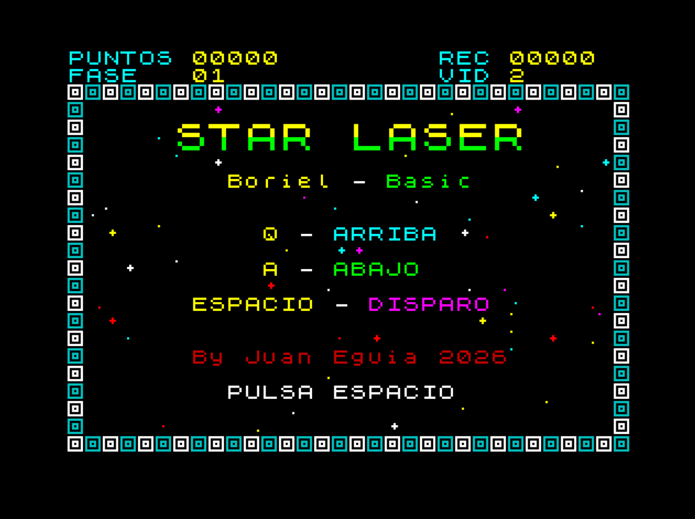
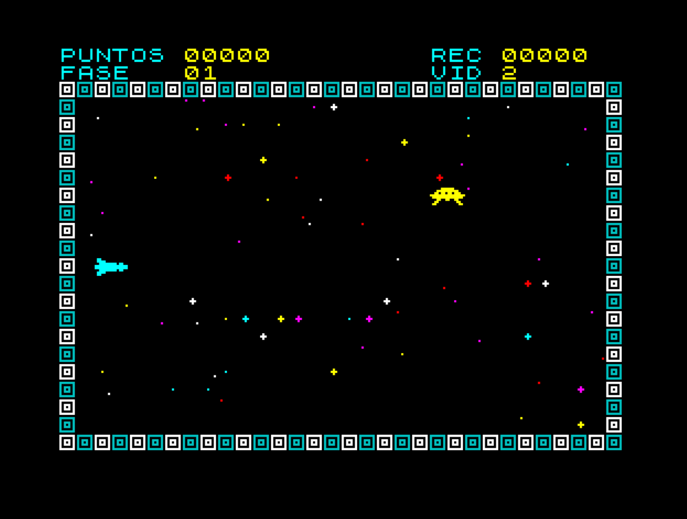
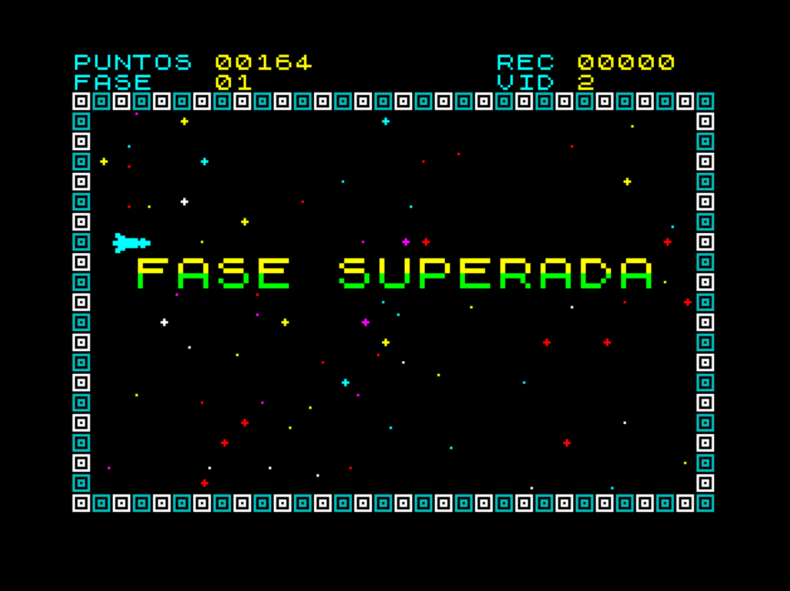
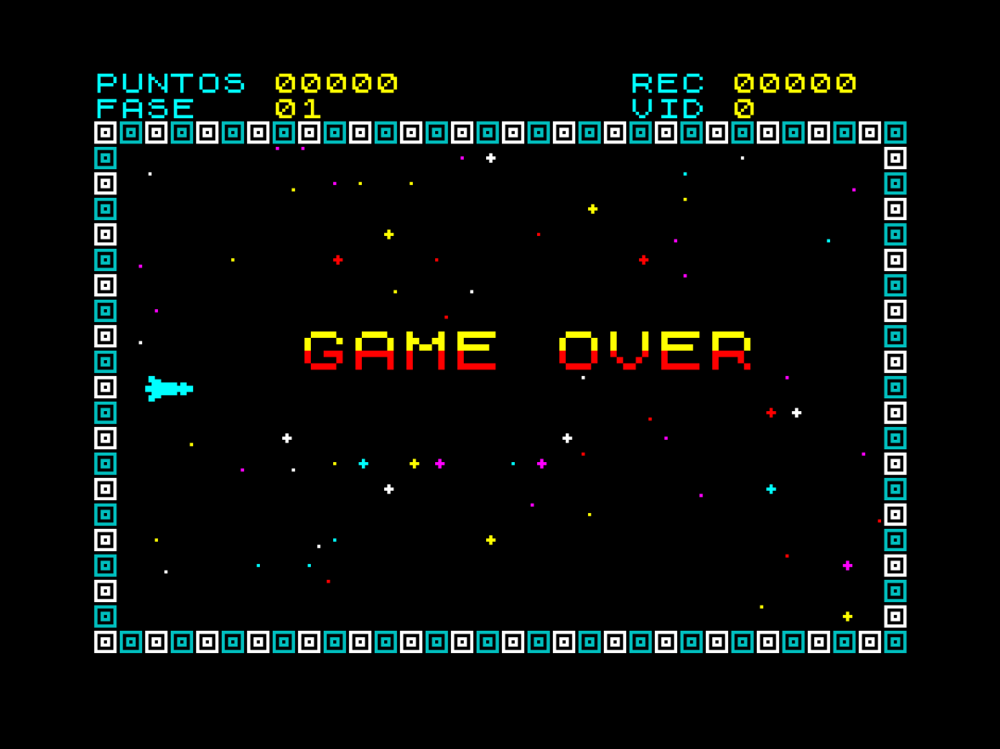

# ***STAR LASER*** — juego para ZX Spectrum 48K

### Programado en Boriel ZX Basic por Juan Eguía

**STAR LASER** es un matamarcianos para el **ZX Spectrum 48K**. Pilotas una nave en el lado izquierdo de la pantalla y tienes que derribar con tu láser las naves enemigas que llegan desde la derecha antes de que crucen la pantalla o choquen contigo.

El juego tiene **7 fases**, cada una más rápida que la anterior, y una pantalla final de victoria.

---

## Capturas

| | |
|---|---|
|  |  |
| *Pantalla de título* | *En plena partida* |
|  |  |
| *Fase superada* | *Game over* |

---

## Índice

- [Cómo jugar](#cómo-jugar)
- [Controles](#controles)
- [El juego](#el-juego)
- [Puntuación](#puntuación)
- [Capturas](#capturas)
- [Compilar el código](#compilar-el-código)
- [Estructura del proyecto](#estructura-del-proyecto)
- [Detalles técnicos](#detalles-técnicos)
- [Autor y licencia](#autor-y-licencia)

---

## Cómo jugar

1. Compila el juego (ver [Compilar el código](#compilar-el-código)) para obtener `main.tap`.
2. Ábrelo con un emulador de ZX Spectrum, por ejemplo **Fuse**, **ZEsarUX**, **Spectaculator**, **Retro Virtual Machine** o uno online como **JSSpeccy** / **Qaop**.
3. Elige un **ZX Spectrum 48K** y carga la cinta (`LOAD ""`; casi todos los emuladores lo hacen solos al abrir el fichero).
4. En el título suena la música: pulsa **ESPACIO** para empezar (también puedes cortar la melodía con ESPACIO).

---

## Controles

| Tecla | Acción |
|---|---|
| **Q** | Mover la nave hacia arriba |
| **A** | Mover la nave hacia abajo |
| **ESPACIO** | Disparar el láser |

---

## El juego

- **Objetivo:** acabar con todas las naves enemigas de cada fase. En cada fase llegan entre **8 y 12 enemigos**, de uno en uno.

- **La nave** se queda siempre en la misma columna, a la izquierda, y solo se mueve arriba y abajo.

- **El láser** es instantáneo: cruza toda la fila de la nave y destruye al enemigo si está en esa misma fila. Entre disparo y disparo hay un pequeño tiempo de recarga.

- **Los enemigos** aparecen por la derecha en una fila al azar y avanzan hacia la izquierda. Cambian de color en cada fase.

- **Vidas:** empiezas con **2**. Pierdes una si:
  - un enemigo **choca** contra tu nave, o
  - un enemigo **llega al borde izquierdo** de la pantalla (el borde se pone rojo).

  En los dos casos ese enemigo cuenta como eliminado, así que puedes pasar la fase aunque se te escape alguno, siempre que te queden vidas.

- **Vidas extra:** se consiguen a los **1000** y a los **3000** puntos. En el marcador aparece el aviso **VIDA EXTRA!** durante unos segundos.

- **Marcadores:** puntos, récord, fase actual y vidas.

- **Final:** al superar la última fase aparece una pantalla de victoria con tu puntuación.

---

## Puntuación

Cada enemigo derribado con el láser da **(10 + extra) × número de fase** puntos. El extra depende de lo lejos que esté el enemigo al derribarlo: **cuanto antes lo derribes, más puntos**.

| Columna del enemigo | 29–28 (recién aparecido) | 25 | 21 | 17 | 13 | 9 | 5 o menos |
|---|---|---|---|---|---|---|---|
| Extra | +12 | +10 | +8 | +6 | +4 | +2 | 0 |
| Puntos en la fase 1 | 22 | 20 | 18 | 16 | 14 | 12 | 10 |
| Puntos en la fase 7 | 154 | 140 | 126 | 112 | 98 | 84 | 70 |

Los enemigos que chocan contigo o se escapan por la izquierda no dan puntos.

---

## Compilar el código

El juego se compila con **[Boriel ZX Basic](https://zxbasic.readthedocs.io/)** (`zxbc`):

```
zxbc -t -B -a main.bas
```

- `-t` genera un fichero de cinta `.tap`
- `-B` añade un cargador BASIC
- `-a` hace que el juego arranque solo al cargar

`main.bas` incluye el resto de ficheros. El resultado es `main.tap`. Los `.tap` no se suben al repositorio (están en `.gitignore`).

---

## Estructura del proyecto

| Fichero | Contenido |
|---|---|
| `main.bas` | Punto de entrada: lista de `#include`, inicialización y bucle título → partida → final |
| `constants.bas` | Constantes (`#define`): área de juego, velocidades, número de fases, vidas, colores, puertos de teclado… |
| `variables.bas` | Variables globales: puntuación, nave, enemigo, fondo de estrellas, tablas de colores y vidas extra |
| `utils.bas` | Utilidades: números aleatorios, lectura del teclado, esperas por fotogramas |
| `sound.bas` | Efectos de sonido y melodías (título, preparado y victoria) |
| `graphics.bas` | UDGs, dibujo de la nave, enemigos, bordes y estrellas, y la explosión de partículas |
| `hud.bas` | Marcadores y aviso de vida extra |
| `enemies.bas` | Aparición de enemigos y choque con la nave |
| `game.bas` | Lógica de la partida: movimiento, disparo, puntuación, vidas y fases |
| `screens.bas` | Pantallas de título, game over y victoria, y el texto en letras grandes |

---

## Detalles técnicos

- **Máquina:** ZX Spectrum 48K.

- **Gráficos en celdas de 8x8:** la nave, los enemigos, el láser, las estrellas y los bordes son **UDGs** colocados en celdas de carácter, así no hay conflicto de atributos.

- **Fondo de estrellas:** se guarda en una matriz con el tipo y el color de la estrella de cada celda. Cuando algo se mueve o se borra, la celda se repinta desde esa matriz, así las estrellas nunca desaparecen.

- **Explosiones de partículas:** 16 puntos que salen hacia fuera desde el centro, dibujados píxel a píxel con `PLOT` en modo **XOR** (`OVER 1`), que cambian de color mientras se alejan.

- **Letras grandes:** los títulos ("STAR LASER", "FASE SUPERADA", "GAME OVER", "ENHORABUENA!") se dibujan a doble ancho y doble alto a partir de la fuente de la ROM, escribiendo directamente en la memoria de pantalla.

- **Melodías:** cada melodía es una tabla de notas y duraciones que se toca con `BEEP`.

---

## Autor y licencia

- **Juan Eguía** — [github.com/juan1639](https://github.com/juan1639)

Distribuido bajo la **licencia MIT**: consulta el fichero [LICENSE](LICENSE).
